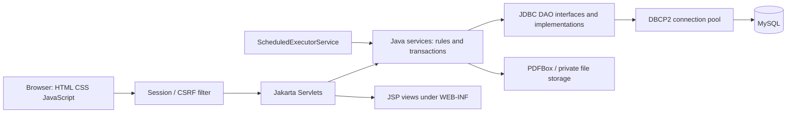

> This playbook describes the earlier browser frontend. The current professor-required frontend is JavaFX: use [the JavaFX guide](JAVAFX-DEPLOYMENT.md) for launch and architecture. JDBC, MySQL, priority-queue and business-rule explanations below still apply.

# Presentation playbook — E-Healthcare Clinic Manager

## Prepare on October 22 before presenting

Use this laptop: the app runs locally and does not need internet once Maven dependencies are cached. GitHub contains source code, not a hosted running website.

```sh
cd '/Users/nishchay/Documents/clinic manager'
./scripts/prepare-presentation.sh
```

The default date is the current clinic date in Asia/Kolkata. This creates a NEW fictional database, preserves previous databases and switches only the ignored local configuration. It builds the latest WAR and restarts Tomcat. It does not destroy existing records. Allow a minute, then open:

**http://localhost:8081/clinic-manager/**

For a rehearsal today, run the same command today. To prepare tomorrow's records ahead of time, append `2026-10-22`; consultation actions on those visits become valid on that date. If restarting without refreshing data, use `./scripts/start-demo.sh`.

Credentials (all fictional, password `ClinicDemo!2026`):

| Role | Login |
|---|---|
| Admin | admin@clinic.demo |
| Doctor | doctor@clinic.demo |
| Patient | patient@clinic.demo |

Use separate browser profiles or different browsers for each role. Ordinary tabs share a session: signing in as a doctor in another tab also changes the patient tab's session. If only one browser is available, use its regular window and a private window, or explicitly sign out between roles.

Keep `docs/fictional-report.pdf` ready in the file picker. Keep the charger connected, disable distracting notifications and check the app before leaving home. Fallback screenshots are saved in `docs/screenshots/`. Separate headless Chrome checks exercised all three roles, booking, severity updates and consultation drafts/completion. Rehearse once yourself before presenting.

## Opening: 30–45 seconds

> Good morning. My project is E-Healthcare Clinic Manager, a Java web application for managing clinic operations. It addresses appointment conflicts, patient queue prioritization, missed visits, and scattered medical records. It has separate patient, doctor, and administrator roles. The interface connects to real Java servlets and a MySQL database, so actions persist instead of being simulated in the browser.

## Eight-minute walkthrough

| Time | Screen/action | Explain |
|---|---|---|
| 0:00–0:45 | Landing page | Problem, three roles, real database |
| 0:45–2:00 | Patient → Find a doctor → book an available future slot | Availability comes from working hours and breaks. The server rechecks before committing. Open My appointments to prove persistence. |
| 2:00–2:45 | Patient → My documents → upload fictional-report.pdf → search FICTIONAL → preview | Server validates PDF, stores it outside the public web folder and extracts text with PDFBox. |
| 2:45–4:30 | Doctor → Severity & patient queue | Show Emergency before Urgent before Routine. Change a routine patient's severity with a reason; show the queue refresh. This is the strongest Java algorithm demonstration. |
| 4:30–5:30 | Doctor → start a checked-in visit → Consultation | Read medical history; save a draft, reopen it, then complete with fictional notes. Show the saved consultation in Patient records. |
| 5:30–6:30 | Admin → User management → create doctor; Reports → export CSV | Doctor accounts are administered, not publicly self-assigned. Reports use actual stored data. |
| 6:30–7:30 | Architecture diagram / selected source files | Servlet/JSP/JDBC layers, transactions, PriorityQueue, OOP, scheduler and security |
| 7:30–8:00 | Tests and limitations | State 47 passing Java tests and 12 HTTP workflow groups; distinguish tested in-app reminders from untested external SMTP. |

Do not try to show every menu. A smooth patient-to-doctor workflow is stronger than rushing through many forms.

### Patient workflow details

1. Sign in as `patient@clinic.demo`.
2. Find a doctor; choose an available slot tomorrow or later. Do not choose a past time or a cancellation-cutoff slot.
3. Enter `Fictional presentation visit` and confirm the booking.
4. Open My appointments, inspect details/history, optionally reschedule to another free future slot.
5. Upload the provided sample PDF as Lab report. Search `FICTIONAL`, preview it and show the extracted text if available.
6. Say: “Knowing a document ID is not enough. The server checks ownership or an authorized care relationship on every download.”

### Severity demonstration details

A fresh demo includes three checked-in fictional patients under `doctor@clinic.demo`:

| Patient | Initial severity | What to point out |
|---|---|---|
| Kabir Shah | Emergency | Highest default priority even if arriving later |
| Priya Kapoor | Urgent | Next priority |
| Aarav Patel | Routine | Lower priority despite earlier arrival |

Open **Severity & patient queue**. Assess Aarav as Urgent with reason `Fictional classroom demonstration of priority update`. Aarav should move before Priya because they now share priority and Aarav arrived earlier. Revert after explaining if desired.

> The comparator first checks recorded severity, then arrival time, then a stable ID. Java's PriorityQueue uses this ordering. We poll entries to produce an ordered list; simply iterating a PriorityQueue would not guarantee sorted order. Queue state is saved in MySQL and reconstructed, so restarting the application does not lose it.

Actual triage is performed by trained staff. This application neither diagnoses urgency from symptoms nor replaces emergency services. Patients cannot mark themselves Emergency.

### Consultation demonstration details

Choose a visit dated TODAY. Start visit changes CHECKED_IN to IN_PROGRESS. The consultation form accepts clinician-entered notes, diagnosis, prescription text and follow-up date. Use clearly fictional text, for example `Classroom demonstration only; no real diagnosis or medication advice`.

Save a draft, reopen to prove persistence, then Save & complete visit. Completion writes a clinical record and appointment history in one transaction and removes the visit from the waiting queue. Completed notes are read-only. Do not promise an edit-after-completion workflow.

## Architecture explanation: one minute



> The browser submits forms or Fetch requests. Filters check the session and CSRF token. Servlets route requests; services validate business rules and use prepared JDBC statements and DAO abstractions. MySQL persists the data. DBCP2 reuses connections. JSP builds the page shell, and JavaScript supplies interactive forms and charts.

Some transactional SQL remains in service classes so all steps share one connection. Do not describe the project as Spring Boot, React, AI diagnosis, or a completely ORM-based system: it uses none of those.

## Java and OOP points to show in code

| Concept | Concrete evidence | Explain in one sentence |
|---|---|---|
| Inheritance / abstraction | `model/User.java`, `Patient.java`, `Doctor.java`, `Admin.java` | A small role hierarchy shares identity fields and requires role behavior. |
| Encapsulation | private final User fields and getters; immutable PatientQueueEntry record | State is controlled rather than exposing mutable public fields. |
| Interfaces | `dao/IUserDAO.java`, other DAO interfaces and `dao/impl/` | Services can depend on a contract rather than one storage implementation. |
| Polymorphism | role method overrides, Comparator, ReminderService.EmailSender | A common interface supports different behavior. |
| Collections | `triage/PatientQueueEntry.java`, `TriageService.java` | PriorityQueue implements severity-based queue ordering with deterministic ties. |
| Concurrency | `service/AppointmentService.java` | Consistent doctor→patient→appointment locking prevents booking races. |
| Transactions | booking, rescheduling, consultation completion | Commit related changes together; roll back on failure. |
| Background work | `listener/AppListener.java`, scheduler classes | ScheduledExecutorService starts/stops with the web application. |
| File handling | DocumentService and PdfValidator | Validate, store, extract, authorize and stream files safely. |

The runtime JSON responses use maps; the User hierarchy is an explicit educational domain example, not the mechanism enforcing permissions. Actual access checks occur in filters/services. Explain that distinction if asked.

## Likely viva questions

**Why Java PriorityQueue?** It naturally models “serve the highest-priority entry next.” Offer/poll are O(log n), peek O(1). The current implementation rebuilds the active queue on reads and polls it into sorted output, approximately O(n log n) for the full list.

**How is double booking prevented?** The transaction locks the doctor and patient rows, rechecks overlap and availability, and inserts only if valid. A generated unique active-slot constraint provides additional protection for identical start times. A frontend availability check alone would race.

**What if a database operation fails halfway?** The service rolls back the transaction, so partial consultation/status or appointment/history changes are not committed.

**How is SQL injection prevented?** User input is bound to PreparedStatement parameters; dynamic identifiers come from fixed application code.

**How are passwords protected?** BCrypt hashes with a work factor, session-based login, rate limiting and credential-revision checks that revoke old sessions after password changes/reset. Passwords are not encrypted for later recovery.

**What is CSRF versus XSS?** CSRF tricks a signed-in browser into submitting a request; server tokens protect writes. XSS injects scripts into a page; output escaping and security headers help prevent it.

**What if the server restarts?** Data and queue entries remain in MySQL, documents remain in private storage, and the scheduler/queue reconstruction resume when Tomcat starts. Sessions may require signing in again.

**Does PDFBox perform OCR?** No. It extracts existing PDF text. Scanned image PDFs remain previewable but require a separate OCR implementation for text search.

**Are reminders real?** Persisted in-app delivery and deduplication were tested. SMTP integration is implemented but real external delivery was not tested because credentials were absent. Email can be at-least-once across a crash after sending.

**Why no public doctor signup?** The original requirement reserves clinical access for admin-created or approved accounts. Public registration can only create patients.

**Which Java version?** Current source targets Java 25; the available local JDK 27 builds/runs it. Maven, Tomcat 10.1, Jakarta Servlets/JSP, JDBC and MySQL are the main stack. Use your machine's actual `java -version` output if asked.

**What is not implemented?** OCR, billing/insurance, signed e-prescriptions, autonomous clinical decisions, and production compliance certification. External SMTP delivery and production load testing remain unverified.

## Closing: 20 seconds

> The project combines Java web development, OOP, JDBC transactions, file processing, priority queues and background scheduling in one clinic workflow. Its main strengths are persistent data, role-based access, safe booking concurrency and staff-controlled severity prioritization. Future work could add OCR, billing and richer operational monitoring after testing and clinical review.

## Fallback if something fails live

- If the app is offline, run `./scripts/start-demo.sh` and wait for “Clinic ready.”
- If queue dates are stale or test visits are completed, run `./scripts/prepare-presentation.sh` before your turn, not during your explanation.
- If a slot becomes unavailable, choose another: that is the booking safeguard working.
- If a PDF is rejected, use the bundled `docs/fictional-report.pdf`.
- If you see 403 after logging in as another role, remember tabs share cookies; sign out and use the intended role.
- If the network is unavailable, use localhost and the local source/test reports. GitHub is optional to the live demo.
- Never claim a failed or untested action succeeded; explain the design and show the relevant passing automated test instead.
